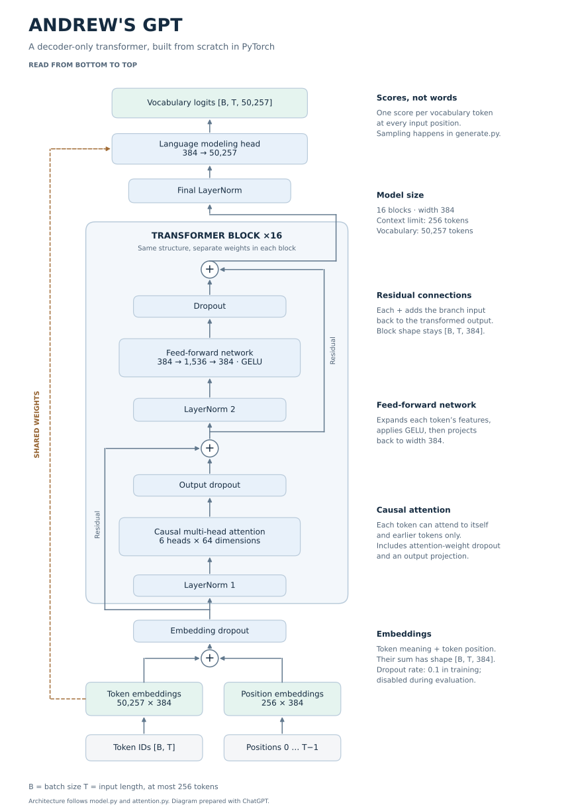
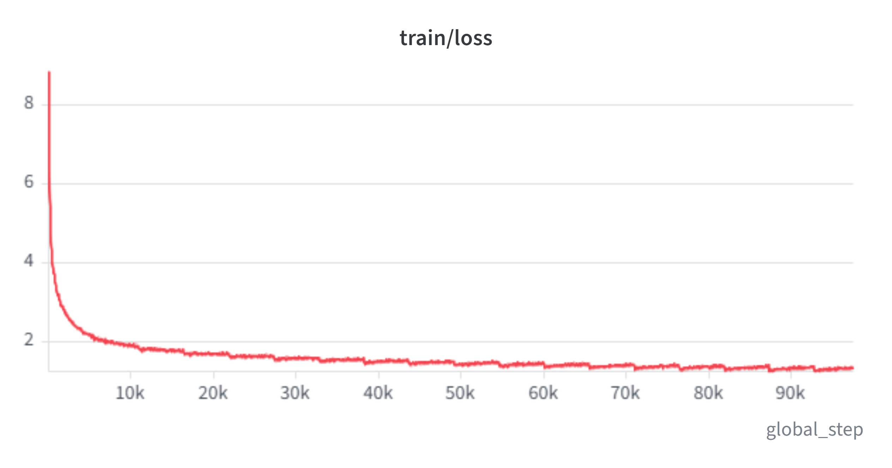
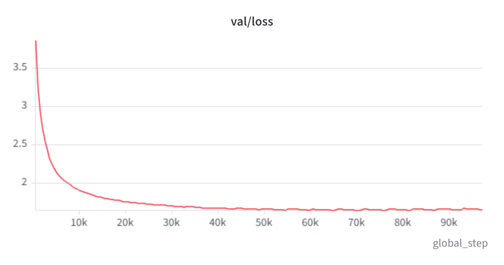

# Andrew's GPT

I built this GPT in PyTorch to understand the full process: preparing data, building the model, training it, evaluating it, and generating text. It uses the GPT-2 tokenizer, but the model weights were trained from scratch on TinyStories.

Give it the beginning of a story, and it predicts one token at a time to continue it. This is a pretrained story model, not an instruction-tuned chatbot.

## What each file does

All Python files are in `gpt/`.

| File | Purpose |
| --- | --- |
| `prepare_data.py` | Splits whole stories into training, validation, and test files, with an end-of-text marker between stories. |
| `dataset.py` | Converts text into token IDs and creates input windows with targets shifted one token ahead. |
| `attention.py` | Lets each token use information from earlier tokens through causal multi-head attention. |
| `model.py` | Assembles embeddings, 16 transformer blocks, and the output head into the GPT. |
| `train.py` | Predicts tokens, calculates loss, and updates weights. Also runs validation, saves checkpoints, and logs to W&B. |
| `test.py` | Loads a trained checkpoint and measures loss and perplexity on held-out stories without changing weights. |
| `generate.py` | Loads the model, samples the next token, and repeats until end-of-text or the output limit. |

## Architecture

16 blocks, 6 attention heads, embedding width 384, and a 256-token context. The output head shares its weights with the token embedding table.



## Results

Trained on 100,000 stories using one NVIDIA H100 on MSOE's ROSIE cluster. The saved checkpoint reached 97,000 optimizer steps during epoch 18.

On the first 1,000 held-out test stories (220,416 evaluated tokens):

- **Test loss:** 1.6478
- **Perplexity:** 5.1957

The model generates dialogue and short story structures, but can repeat itself, change character names, and lose track of objects or events.

### Training loss

Training loss continued decreasing as the model learned to predict tokens in the training stories.



### Validation loss

Validation loss dropped quickly, then mostly leveled off while training loss kept decreasing. More training was giving little improvement on held-out validation stories.



## Run it

With the Python environment activated, place `pretrained-final.pt` in `base_gpt/checkpoints/`. From the repository root:

```bash
python base_gpt/gpt/generate.py
```

Data lives in `gpt_data/`; weights live in `checkpoints/`. Both are excluded from Git, so cloning the code alone does not include them.

## Build your own

The [`skeleton/`](skeleton/) folder contains the same core files with TODOs and short explanations. Work through them step by step to build, train, test, and run your own GPT. You write the important parts yourself.

I implemented the model and worked through the training, testing, and generation code with assistance. Delegated sections are marked in the source.